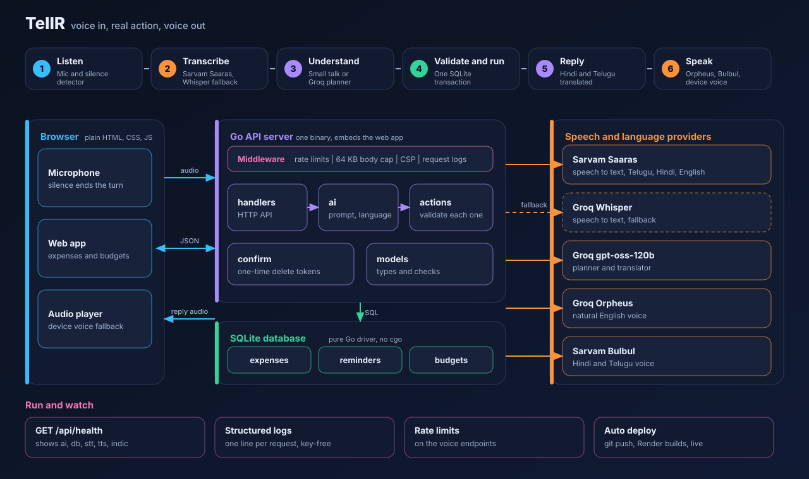
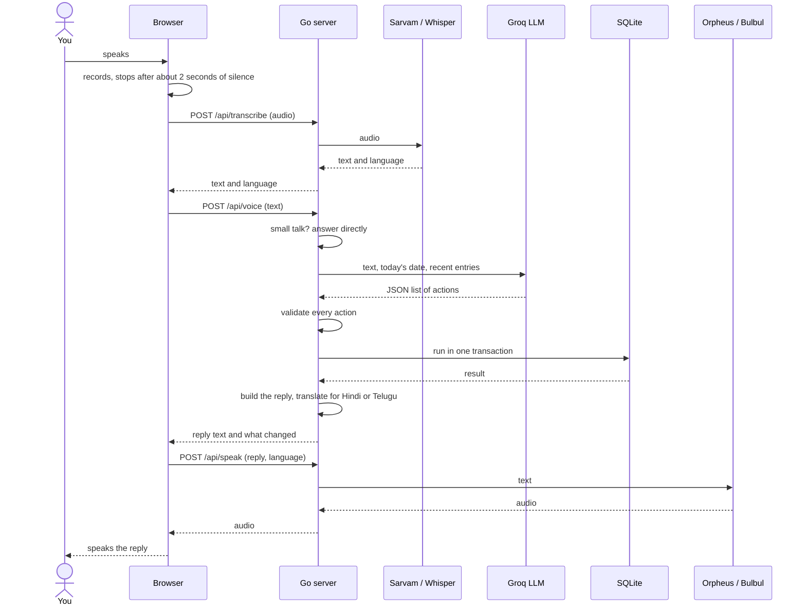
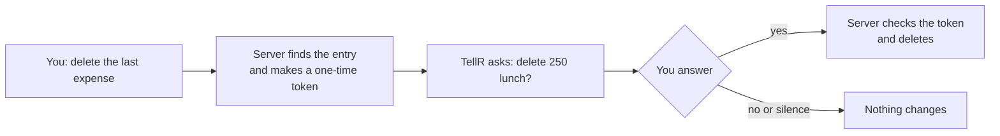

<div align="center">

# TellR

**Say it. TellR does it.**
A voice assistant for money and reminders in English, Hindi and Telugu.

[**Live demo**](https://tellr.onrender.com) · [Architecture](#architecture) · [Run it locally](#run-it-locally) · [API](#api)


</div>

Built solo in six hours for the Vocal Labs Round 2 hackathon. Built with AI assistance (Claude), reviewed and run by me.

> The live demo runs on a free Render plan. It sleeps when idle, so the first load can take up to a minute.

---

## Try these sentences

| You say | TellR does |
|---|---|
| "Spent 250 on lunch and remind me to call mom tomorrow at 6" | Saves the expense and the reminder in one go |
| "How much did I spend this month?" | Speaks a summary and compares it with the last period |
| "Set a food budget of 5000" | Sets a monthly budget and warns at 80% and 100% |
| "Next month add 2000 for medical" | Saves a planned expense for a future date |
| "Make the last expense 300 and transport" | Edits the latest entry |
| "Delete the last expense" | Asks "are you sure?" and deletes only after a spoken yes |
| "आज मैंने चाय पर 50 रुपये खर्च किए" | Understands Hindi and answers in Hindi |
| "ఈ రోజు ఆటోకి 120 ఖర్చు చేశాను" | Understands Telugu and answers in Telugu |

## Features

**Voice**
- Speak naturally. A short pause does not end your turn.
- Auto mode detects English, Hindi or Telugu and replies in the same language.
- Natural voices: Groq Orpheus for English, Sarvam Bulbul for Hindi and Telugu, with a device voice as a fallback.
- Small talk works too: greetings, the time, the date, thanks.

**Money**
- Expenses by category, with search, edit, delete and a daily trend chart.
- Monthly budgets with spoken warnings. Add your own budget names (like "gym" or "trip") and rename them by voice.
- Summaries for today, the last 7 days, this month, or week 1 to 4 of the month.
- Planned expenses up to a year ahead. They count once their date arrives.
- CSV export and CSV import. Duplicates and bad rows are skipped and reported (`samples/demo-expenses.csv` shows the format).

**Reminders**
- One-time or repeating (daily, weekly, monthly). Repeating ones move forward when marked done.
- Alerts appear inside the open page.

**Safety**
- The AI only proposes actions. The server checks every one and runs them in a single database transaction.
- A delete never runs without a spoken or clicked confirmation.

---

## Architecture

### System overview



### One voice command, step by step



### Delete needs a yes



### Where the code lives

| Folder | Job |
|---|---|
| `models` | Data types and validation (amounts, dates, categories) |
| `store` | SQLite storage with a pure Go driver (no cgo) |
| `actions` | Checks and runs the actions the AI proposes |
| `ai` | Groq and Sarvam clients, prompt, speech recognition, small talk, translation |
| `confirm` | Single-use delete confirmations |
| `handlers` | HTTP API, rate limits, CSV import |
| `web` | The single-page frontend, embedded into the binary |

### Design decisions

- **The model never touches the database.** It returns a JSON plan. Go checks amounts, ids, dates and categories before anything is written.
- **One binary, no build step.** The frontend is embedded, so deploying means running one file.
- **Pure Go SQLite.** No cgo, so it builds anywhere.
- **Language follows the text.** The reply language comes from the script of what you said, not from a setting, so Hindi never gets a Telugu answer.
- **Fallbacks everywhere.** Sarvam falls back to Whisper for recognition. Sarvam and Orpheus fall back to the device voice.

---

## Run it locally

Needs a recent Go version (see `go.mod`). The Render build uses Go 1.27.

```bash
export GROQ_API_KEY=your_key_here
export SARVAM_API_KEY=your_key_here
go run .
```

Open http://localhost:8080 in Chrome.

- Without a Groq key, the forms still work and voice commands are off.
- Without a Sarvam key, Hindi and Telugu still work through Groq Whisper and device voices, with lower quality.

Run the tests with `go test ./...`.

### Configuration

| Variable | Default | Purpose |
|---|---|---|
| `GROQ_API_KEY` | none | Groq key, read from the environment only |
| `SARVAM_API_KEY` | none | Sarvam key for Hindi and Telugu recognition and voice |
| `PORT` | 8080 | HTTP port |
| `DB_PATH` | data/tellr.db | SQLite file |
| `GROQ_MODEL` | openai/gpt-oss-120b | Planner model |
| `GROQ_STT_MODEL` | whisper-large-v3-turbo | Speech recognition fallback |
| `GROQ_STT_INDIC_MODEL` | whisper-large-v3 | Whisper model for Hindi and Telugu fallback |
| `GROQ_TTS_MODEL` | canopylabs/orpheus-v1-english | Natural English voice |
| `SARVAM_STT_MODEL` | saaras:v4 | Sarvam speech recognition |
| `SARVAM_MODEL` | bulbul:v3 | Sarvam voice model |
| `SARVAM_SPEAKER` | priya | Sarvam voice |
| `TRUSTED_PROXY` | false | Set to true behind Render or another proxy |

### Deploy on Render

1. Create a Web Service from this repo, language Go.
2. Build command: `go build -tags netgo -ldflags '-s -w' -o app`. Start command: `./app`.
3. Add `GROQ_API_KEY`, `SARVAM_API_KEY` and `TRUSTED_PROXY=true`.

## API

| Method | Path | Purpose |
|---|---|---|
| POST | `/api/transcribe` | Audio in, text and language out |
| POST | `/api/voice` | Text in, actions run, reply out |
| POST | `/api/speak` | Reply text in, audio out |
| POST | `/api/confirm` | Confirm or cancel a delete |
| GET, POST, PUT, DELETE | `/api/expenses` | Expenses |
| GET, POST, DELETE | `/api/reminders` | Reminders, plus `/done` to mark one done |
| GET, PUT, DELETE | `/api/budgets` | Monthly budgets |
| GET | `/api/summary`, `/api/daily` | Totals and the daily trend |
| GET, POST | `/api/export.csv`, `/api/import` | CSV export and import |
| GET | `/api/health` | Which services are connected |

---

## What is real and what is not

**Real**
- Voice input, AI planning, database writes, spoken replies and in-page reminder alerts all work end to end.
- Hindi and Telugu input and replies, with natural Sarvam voices when a Sarvam key is set.
- CSV import and export.

**Limits, stated honestly**
- There is no login. Anyone with the URL shares one dataset. This is a demo.
- Reminders alert inside the open page. There is no email, SMS or WhatsApp.
- Hindi and Telugu replies are machine-translated from English.
- The natural English voice needs its terms accepted once in the Groq console. Without it, the app uses your device's voice.
- Voice quality and recognition depend on third-party services (Groq, Sarvam) and their free-tier limits. Heavy use can show an "AI is busy" message.
- Auto language detection can still misjudge very short phrases. Pick the language manually if it does.
- On a free hosting plan the app sleeps when idle and may lose its data on restart.
- Live data (weather, news) is not available to the assistant.
